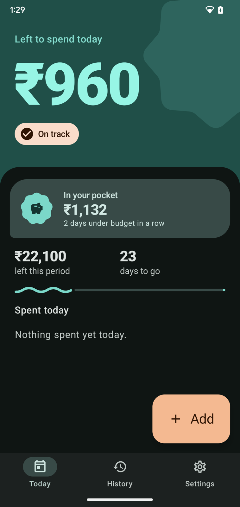
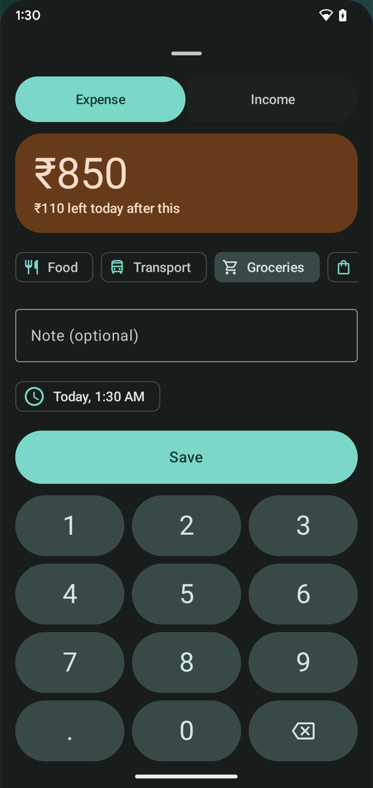
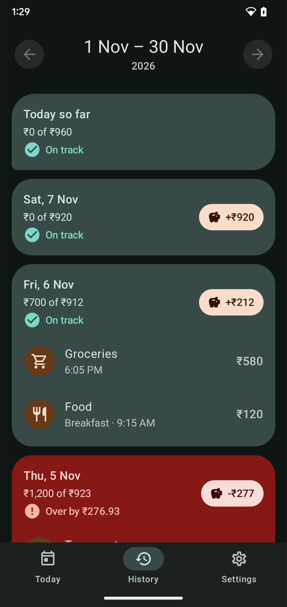
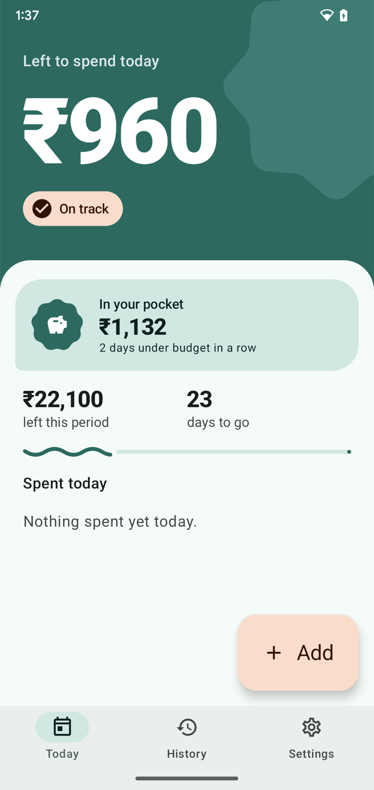
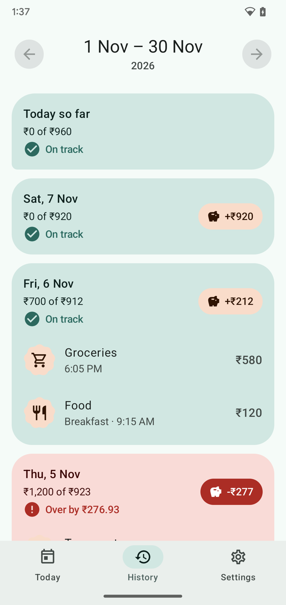

<p align="center">
  
</p>

<h1 align="center">Kisha</h1>

<p align="center">
  <b>How much can I spend today?</b><br>
  An offline, open-source daily-allowance expense tracker for Android.
</p>

<p align="center">
  <a href="https://github.com/highlandev210/kisha/releases/latest"></a>
  <a href="https://github.com/highlandev210/kisha/actions/workflows/ci.yml"></a>
  <a href="LICENSE"></a>
  
</p>

---

Kisha (കീശ, Malayalam for *pocket*) turns your monthly budget into one number: what's left to spend **today**. Tell it your income and the money that's already spoken for (rent, EMIs, subscriptions), and Kisha spreads the rest across the days left. Spend less than today's allowance and the leftover drops into your **pocket** at midnight.

<p align="center">
  
  
  
  
  
</p>

## Features

- **Today's number.** `(income − fixed costs − spent so far) ÷ days left`, recalculated every midnight. Underspend and tomorrow's number rises; overspend and it falls.
- **Colour you can read at a glance.** Teal when you're on track, amber when running low, red when you're over, always with words and an icon too.
- **The pocket.** Each finished day's unspent allowance drops in with a coin animation, and overspending takes it back out. Keep your under-budget streak going.
- **Two-tap logging.** A big keypad, optional category, note and time. The colour previews today's state before you save.
- **History as day tiles.** Spent vs allowance, and what each day did to your pocket.
- **Your pay cycle.** Calendar months or payday cycles (any day of the month, or the last working day).
- **Indian defaults.** ₹ and lakh grouping (1,00,000), switchable to international.

## Private by design

- **No internet permission.** Kisha can't send your data anywhere.
- No account, ads, analytics, crash reporting or Google Play Services.
- Cloud backup is disabled. Your data stays on your phone.

## Download

Get the APK from [**Releases**](https://github.com/highlandev210/kisha/releases/latest) and install it (Android 10 or newer). Each release has a `.sha256` checksum next to the APK.

To get updates automatically, add this repository to [Obtainium](https://github.com/ImranR98/Obtainium).

## Build from source

Requirements: JDK 25 (Android Studio's bundled JBR works, and Gradle downloads one if it's missing) and the Android SDK.

```sh
git clone https://github.com/highlandev210/kisha.git
cd kisha
./gradlew :app:assembleDebug            # app/build/outputs/apk/debug/app-debug.apk
./gradlew :core:allowance:test :app:testDebugUnitTest   # JVM tests
./gradlew :app:connectedDebugAndroidTest               # device tests (needs a phone or emulator)
```

Release builds are signed only when `KISHA_KEYSTORE_FILE`, `KISHA_KEYSTORE_PASSWORD`, `KISHA_KEY_ALIAS` and `KISHA_KEY_PASSWORD` are set; otherwise `assembleRelease` produces an unsigned APK.

## How it's built

100% Kotlin and Jetpack Compose with **Material 3 Expressive**. All the budget maths (cycles, the allowance and the pocket) lives in a pure-Kotlin module, [`core/allowance`](core/allowance), with its own unit tests. The app stores data in Room (SQLite) with tested migrations and uses manual dependency injection.

## Roadmap

- **Scan & Pay**: scan a UPI QR, log the expense, then pay in your UPI app of choice.
- **Backup and export** to a file you control (JSON and CSV).
- **Kisha for Claude and Codex**: a desktop MCP companion that reads your exported data, so you can ask an AI about your spending without Kisha itself going online.
- Home-screen widget, reminders, insights and Malayalam.

## Releasing

1. Bump `versionCode` and `versionName` in [`app/build.gradle.kts`](app/build.gradle.kts) and add a section to [`CHANGELOG.md`](CHANGELOG.md).
2. Tag and push: `git tag v0.1.0 && git push origin v0.1.0`.
3. The [Release workflow](.github/workflows/release.yml) runs the tests, builds a signed APK and publishes a GitHub Release using that changelog section.

The signing key is created once with [`scripts/create-release-key.sh`](scripts/create-release-key.sh). Keep a backup of it: without it, future versions can't update existing installs.

## Contributing

Issues and pull requests are welcome. See [CONTRIBUTING.md](CONTRIBUTING.md).

## License

[Apache License 2.0](LICENSE)
